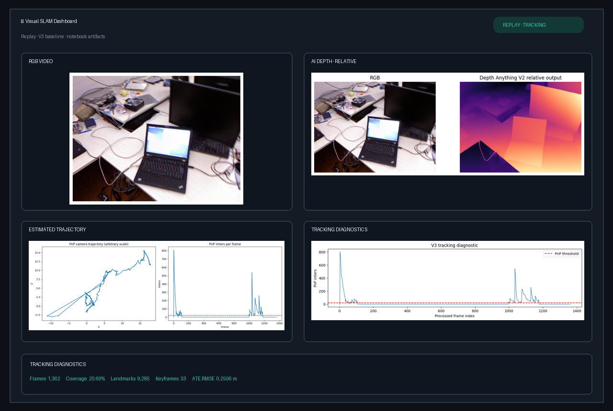
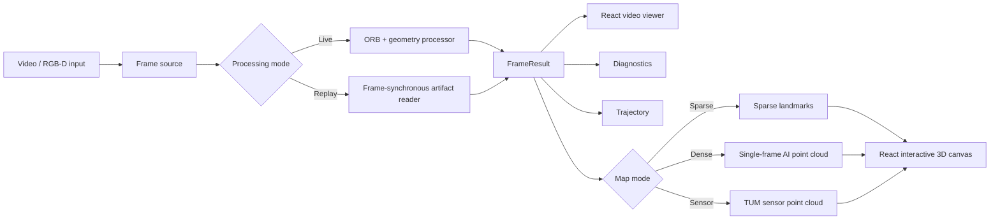
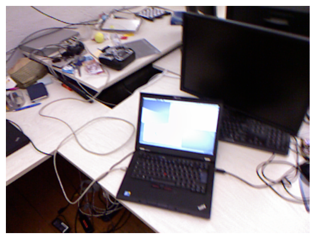
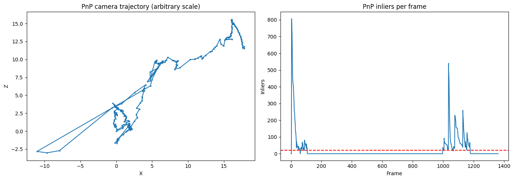
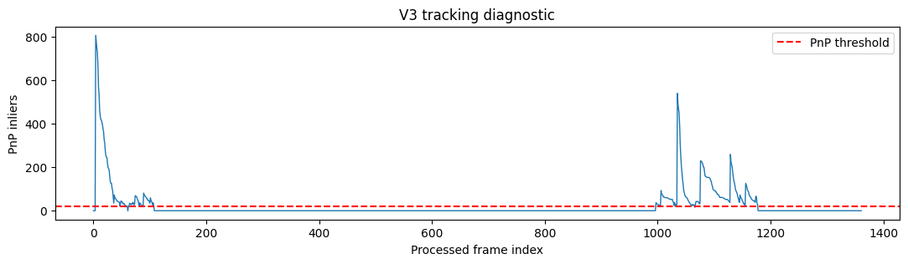
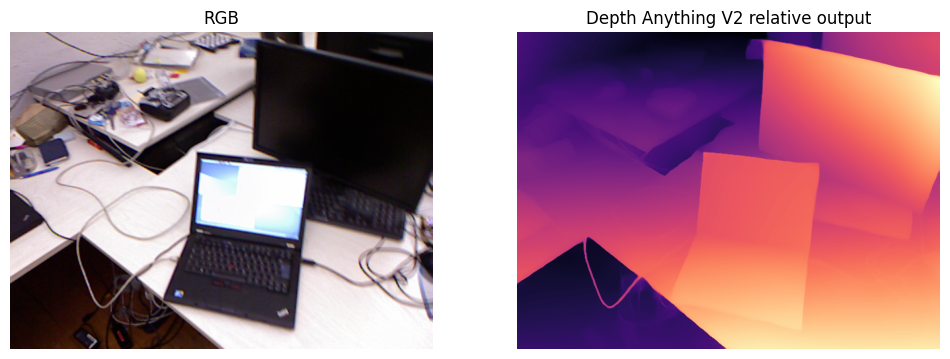
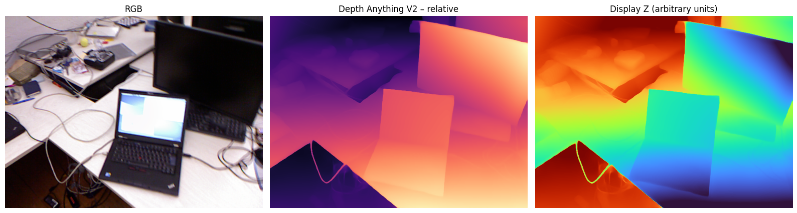
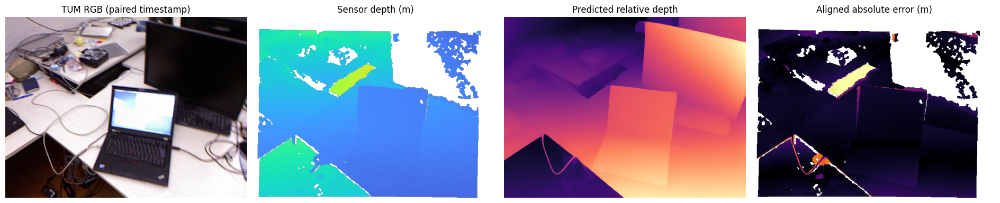
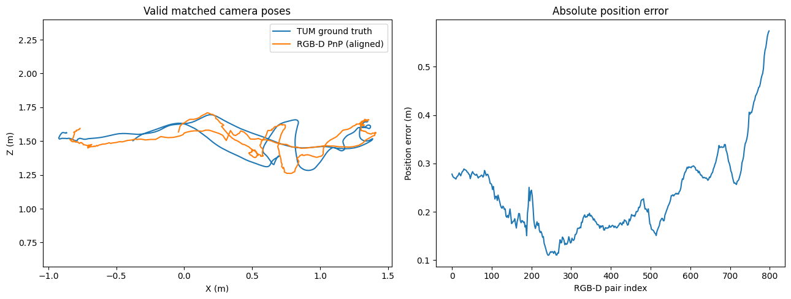
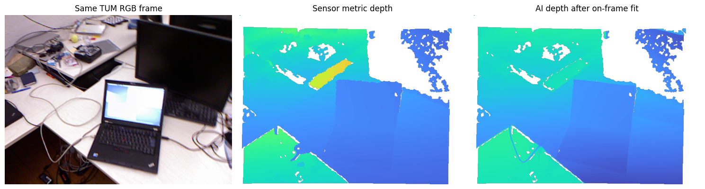

# Visual SLAM Dashboard

React + FastAPI dashboard for a classical computer-vision visual odometry and 3D reconstruction project. The application turns the existing notebook outputs into a demoable portfolio project while keeping the experimental boundaries explicit:

- **Replay Mode** is frame-synchronous playback of the checked-in notebook artifacts.
- **Live Processing** uploads a selected video to FastAPI and streams a CPU-friendly ORB + Essential Matrix path over WebSocket.
- Missing poses remain missing. A `LOST` frame never invents a camera position or trajectory segment.
- Depth Anything V2 is treated as relative single-frame depth unless metric scale alignment is available.



The preview above uses real RGB, depth, trajectory, and tracking plots extracted from the current notebook. Run the React frontend and FastAPI backend for the interactive 3D viewport and live video path.

## Project overview

Visual odometry estimates camera motion from image observations. Visual SLAM extends this idea with a persistent map and relocalization. This project explores the classical geometry needed to recover camera motion and sparse structure from RGB video, then compares it with RGB-D tracking and depth-assisted visualization.

**Input:** RGB video, webcam-compatible capture, or the exported TUM RGB-D artifacts.

**Output:** estimated camera trajectory, sparse 3D landmarks, relative depth visualization, colored point clouds, and tracking diagnostics.

Monocular mode has arbitrary scale and does not use ground truth for tracking. RGB-D mode uses measured sensor depth for metric visual odometry and reserves ground truth for evaluation only.

## System architecture



The core/UI boundary is the `FrameResult` dataclass. FastAPI converts processing state into REST/WebSocket payloads; React renders that state without embedding the algorithm in the browser.

## Methodology

The notebook baseline contains:

- ORB keypoint detection and Hamming descriptor matching.
- Essential Matrix, `recoverPose`, and triangulation for monocular initialization.
- Lucas–Kanade optical flow, local map matching, PnP + RANSAC, and keyframe relocalization in the V3 tracker.
- Sparse map and keyframe management in arbitrary monocular scale.
- Depth Anything V2 relative depth and RGB back-projection for single-frame visualization.
- TUM RGB-D frame-to-frame PnP with measured depth and timestamp-aligned evaluation.

The dashboard's live path is intentionally smaller and CPU-oriented. The checked-in V3 notebook artifacts remain the reference for the portfolio benchmark.

## Experimental results from the repository

These values are read from `visual_slam_upgrade/tracking.json`, `tracking_diagnostics.json`, `rgbd_trajectory_metrics.json`, and `trajectory.csv` rather than typed into the application logic.

| Metric | Recorded result |
| --- | ---: |
| Frames in trajectory artifact | 1,362 |
| Monocular tracked frames | 281 |
| Monocular tracking coverage | 20.69% |
| Longest tracked streak | 111 |
| Sparse landmarks | 9,285 |
| Keyframes | 33 |
| RGB-D tracked poses | 400 |
| RGB-D ATE RMSE | 0.2506 m |

The trajectory artifact contains 1,362 rows, with `NaN` positions for frames where no pose was estimated. No processing FPS is reported because the notebook did not record a reliable wall-clock benchmark.

## Visual results

All images below are extracted from notebook display outputs or generated directly from the checked-in artifacts.

| Result | Evidence |
| --- | --- |
| Original RGB frame |  |
| Estimated trajectory and inliers |  |
| V3 tracking diagnostics |  |
| AI relative depth |  |
| AI depth point-cloud view |  |
| Sensor-depth comparison |  |
| RGB-D trajectory evaluation |  |
| AI vs sensor depth |  |

The PLY files are also retained for interactive inspection in Replay Mode: `sparse_map.ply`, `predicted_depth_single_frame_3d.ply`, and `tum_sensor_single_frame_3d.ply`.

## Installation and usage

Python 3.10+ and Node.js 20+ are recommended. Create a Python environment and install the API dependencies:

```bash
python -m venv .venv
# Windows: .venv\Scripts\activate
# Linux/macOS: source .venv/bin/activate
python -m pip install -r requirements.txt
```

Start FastAPI from the repository root:

```bash
uvicorn server.main:app --reload --port 8000
```

In another terminal, start React:

```bash
cd frontend
npm install
npm run dev
```

Open `http://localhost:5173`. The dashboard starts in Replay Mode when the exported `visual_slam_upgrade/` folder is present. Use:

1. **Replay Mode** to scrub the 1,362-frame trajectory and inspect sparse, AI-depth, or sensor-depth clouds.
2. **Open video** to upload an MP4 to FastAPI. Live frames and diagnostics stream over WebSocket; poses are emitted only after feature geometry passes inlier checks.
3. **AI Depth** to display the stored relative-depth notebook output in Replay Mode. Live AI depth is optional and requires `torch`, `transformers`, and `Pillow` on the API host.
4. Mouse drag, right-drag, and wheel in the 3D viewport for orbit, pan, and zoom.
5. Toggle landmarks, trajectory, and keyframes independently.


